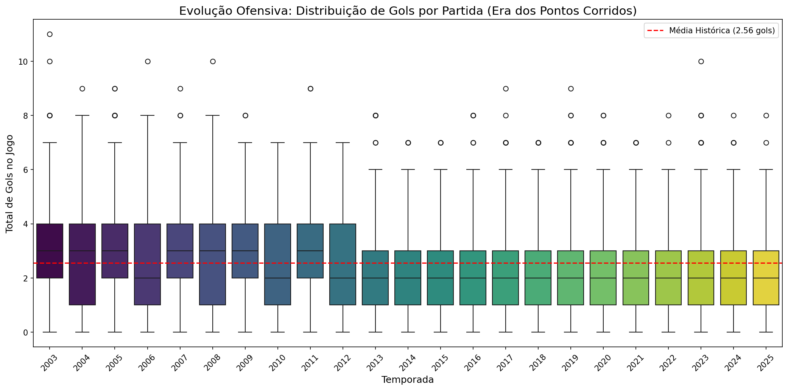
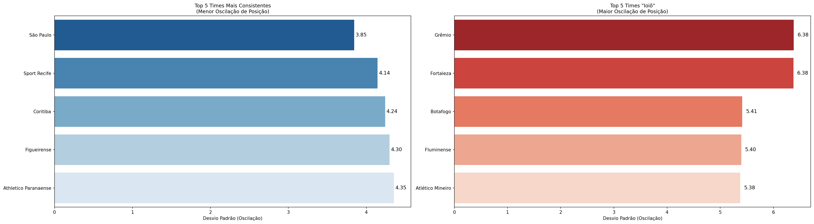
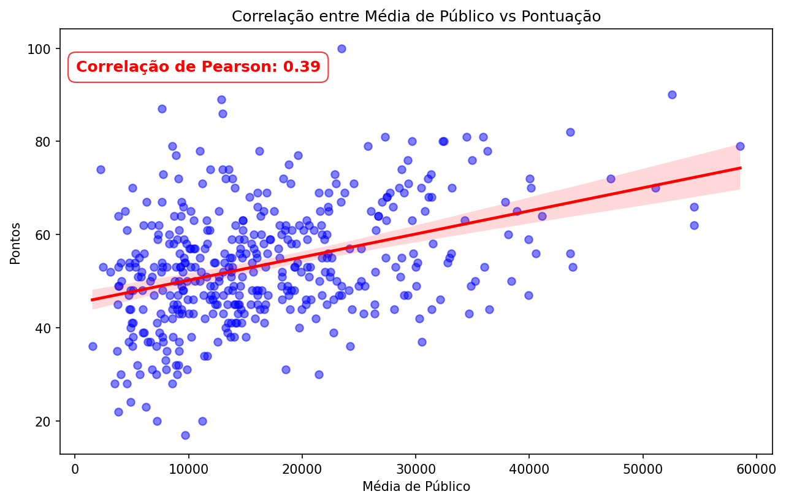
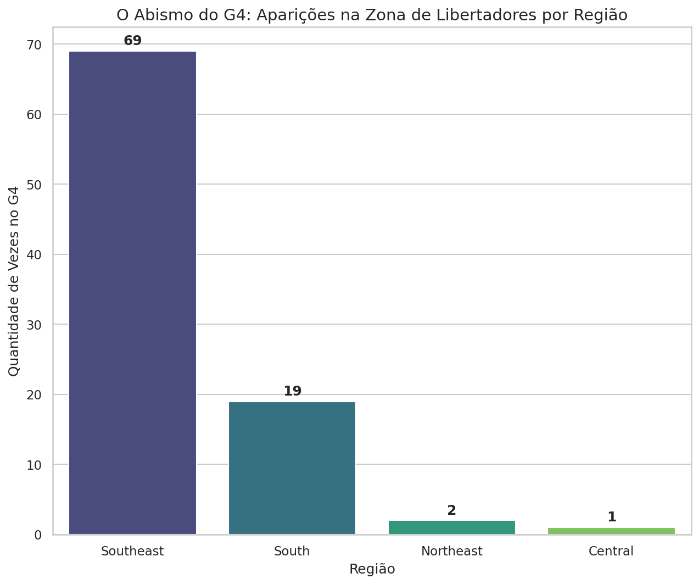

# ⚽ Data Science no Campeonato Brasileiro

> Análise de dados do Brasileirão da era dos pontos corridos (2003–2025), do pipeline de ingestão no **Google BigQuery** até a análise exploratória, visualização e teste de hipótese estatístico em **Python**.

<p align="left">
  
  
  
  
  
</p>

---

## 📌 Sobre o projeto

Este repositório reúne uma série de estudos de Ciência de Dados aplicados ao **Campeonato Brasileiro de futebol**. A proposta vai além do "olhômetro" da bancada de bar: cada análise parte de uma **pergunta ou mito popular do futebol** e o coloca à prova com dados históricos, estatística e visualização.

O projeto cobre o ciclo completo de um trabalho de dados:

1. **Engenharia / ETL** — leitura de arquivos brutos (`.txt`, `.json`, `.xlsx`), transformação com Python e carga estruturada no **Google BigQuery**.
2. **Extração e limpeza** — consultas SQL no BigQuery e tratamento dos dados com Pandas.
3. **Análise Exploratória (EDA)** — agregações, cruzamentos (`merge`) e métricas de negócio.
4. **Estatística** — correlação, desvio padrão e teste de hipótese (Teste T de Student).
5. **Visualização e storytelling** — gráficos com Matplotlib/Seaborn e conclusões orientadas a dados.

---

## 🧭 Arquitetura de dados

```
Fontes brutas (Kaggle: .txt / .csv)          Dados complementares (.xlsx)
        │                                              │
        ▼                                              ▼
  Python (ETL): limpeza, conversão p/ JSON, definição de schema
        │
        ▼
  Google BigQuery  ── dataset: brasileirao_dataset
        │            ├── dados_brazilian_league   (classificações por temporada)
        │            ├── dados_matches            (resultado de cada partida)
        │            ├── dados_public_matches     (média de público por time/ano)
        │            └── dados_teams              (cadastro geográfico dos clubes)
        ▼
  Python (Análise): google-cloud-bigquery → Pandas → Matplotlib/Seaborn/SciPy
```

> 📖 O detalhamento das tabelas e colunas está em [`docs/bigquery_schema.md`](docs/bigquery_schema.md).

---

## 📂 Estrutura do repositório

```
data-science-brasileirao/
├── README.md
├── requirements.txt
├── .gitignore
├── notebooks/
│   ├── 01_pipeline_etl_e_eda.ipynb          # ETL + BigQuery + EDA inicial
│   ├── 02_evolucao_ofensiva_e_consistencia.ipynb
│   ├── 03_fator_casa_e_publico.ipynb
│   ├── 04_raio_x_geografico.ipynb
│   └── 05_teste_de_hipotese.ipynb
├── docs/
│   └── bigquery_schema.md                    # dicionário de dados das tabelas
└── images/                                   # gráficos exportados p/ este README
```

---

## 🔬 Os estudos

### 1. Pipeline de dados + EDA inicial
**[`01_pipeline_etl_e_eda.ipynb`](notebooks/01_pipeline_etl_e_eda.ipynb)**

Constrói a base do projeto: converte os arquivos brutos de partidas (`.txt` → `JSON Lines`), define o *schema* e carrega as tabelas no BigQuery com validação e tratamento de exceções. Em seguida, faz a primeira exploração — edições mais artilheiras, times mais letais e maiores médias de pontos —, incluindo o tratamento de um **viés de amostra pequena** (times com poucas participações distorcendo os rankings).

### 2. A evolução ofensiva e a consistência das equipes
**[`02_evolucao_ofensiva_e_consistencia.ipynb`](notebooks/02_evolucao_ofensiva_e_consistencia.ipynb)**

> *O futebol brasileiro está mais defensivo?* E *quais times são sólidos x quais vivem na montanha-russa?*

Analisa a **média de gols por partida** ao longo das temporadas e usa o **desvio padrão da posição final** para separar os times **consistentes** dos times **"ioiô"**.

### 3. Ciência contra a bancada: o "Fator Casa" e o público
**[`03_fator_casa_e_publico.ipynb`](notebooks/03_fator_casa_e_publico.ipynb)**

> *Jogar em casa garante vantagem? Torcida grande significa título?*

Calcula a taxa de vitória dos mandantes na história e sua evolução, e cruza (`merge`) público médio × pontuação final para medir a **correlação de Pearson**.

### 4. Raio-X geográfico do futebol brasileiro
**[`04_raio_x_geografico.ipynb`](notebooks/04_raio_x_geografico.ipynb)**

> *O Brasileirão é nacional ou é um torneio do Sudeste com convidados?*

Mapeia o domínio do G4 e a distribuição de rebaixamentos por **estado e região**, e testa o **mito das longas distâncias** (viagens longas realmente derrubam o visitante?).

### 5. Teste de hipótese: ataque x defesa
**[`05_teste_de_hipotese.ipynb`](notebooks/05_teste_de_hipotese.ipynb)**

> *"Ataque ganha jogos, defesa ganha campeonatos" — o mito se sustenta?*

Separa os 25% melhores ataques e as 25% melhores defesas e aplica um **Teste T de Student** (SciPy) para verificar, com significância de 5%, se a diferença de pontos entre os perfis é estatisticamente relevante.

---

## 💡 Principais insights

| Estudo | Achado |
|---|---|
| ⚽ **Gols** | Auge ofensivo em **2005 (3,13 gols/jogo)**, fundo do poço em **2018 (2,18)** e leve recuperação a partir de 2020. |
| 🎢 **Consistência** | **São Paulo** é o time menos oscilante (menor desvio padrão); **Grêmio** e **Fortaleza** são as maiores "montanhas-russas". |
| 🏟️ **Fator Casa** | Mandantes vencem **~49,6%** dos jogos — real, mas em queda desde os 54% de 2003. |
| 👥 **Público × título** | Correlação público × pontos é moderada (**0,39**), mas **cai para ~0 entre os campeões** (efeito-teto dos estádios). |
| 🗺️ **Geografia** | Sudeste ocupou o G4 **69 vezes**; atravessar o país muda a vitória do mandante em **apenas ~1%**. |
| 📊 **Ataque × Defesa** | Teste T (**p = 0,014**) rejeita o mito: melhores ataques fazem **~5 pontos a mais** por temporada que melhores defesas. |

---

## 📈 Visualizações

> As imagens abaixo são exportadas dos notebooks. Se você acabou de clonar o repositório e as imagens ainda não aparecem, veja a seção *[Como reproduzir](#-como-reproduzir)*.

<!-- Substitua/adicione as imagens exportadas dos notebooks (pasta images/) -->

| | |
|---|---|
|  |  |
|  |  |

---

## 🛠️ Tecnologias

- **Linguagem:** Python 3.12
- **Data Warehouse:** Google BigQuery + Google Cloud Storage
- **Bibliotecas:** `google-cloud-bigquery`, `pandas`, `numpy`, `matplotlib`, `seaborn`, `scipy`, `openpyxl`, `db-dtypes`
- **Ambiente de desenvolvimento:** Google Colab

---

## ▶️ Como reproduzir

> ⚠️ **Sobre os dados:** as tabelas ficam em um projeto **privado** do Google BigQuery, portanto não estão versionadas neste repositório. O código está totalmente disponível para leitura e é reproduzível caso você recrie as tabelas no seu próprio projeto BigQuery a partir das [fontes de dados](#-fontes-de-dados) e ajuste os IDs de projeto/dataset nos notebooks.

**Opção A — Google Colab (mais simples):**
1. Faça upload dos notebooks da pasta `notebooks/` para o seu Google Drive / Colab.
2. Autentique-se no Google Cloud (`from google.colab import auth; auth.authenticate_user()`).
3. Ajuste `project`, `dataset` e nomes das tabelas para o seu ambiente.

**Opção B — Ambiente local:**
```bash
git clone https://github.com/alysson-feitosa/data-science.git
cd data-science/brasileirao
python -m venv .venv && source .venv/bin/activate   # Windows: .venv\Scripts\activate
pip install -r requirements.txt
jupyter notebook
```
Para o acesso ao BigQuery, configure suas credenciais (`gcloud auth application-default login` ou uma *service account*).

---

## 📚 Fontes de dados

- [Histórico do Campeonato Brasileiro (2003–2024)](https://www.kaggle.com/datasets/lucasyukioimafuko/brasileirao-serie-a-2006-2022) — Kaggle
- [Histórico de partidas e média de público (2003–2019)](https://www.kaggle.com/datasets/rczekster/matches-brazilian-football-from-2003-to-2019) — Kaggle
- Dados complementares de público e classificação (2022–2025) compilados manualmente.

---

## 👤 Autor

**Alysson Leonardo**
🔗 [LinkedIn](https://www.linkedin.com/in/alyssonleonardo/) • 💻 [GitHub](https://github.com/alysson-feitosa)

Projeto desenvolvido como parte do meu portfólio de Ciência de Dados. Feedbacks e ideias são muito bem-vindos! ⚽📊
